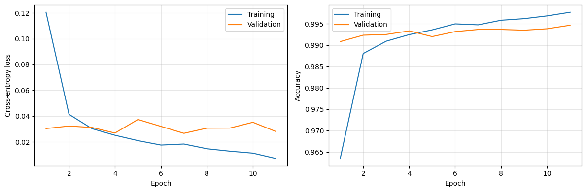
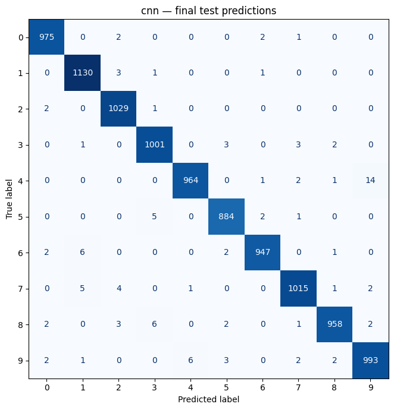

# Atelier 2 — Deep Learning sur MNIST

**PyTorch · CNN · Faster R-CNN · Transfer learning · Vision Transformer**

Ce travail compare cinq architectures pour la reconnaissance de chiffres manuscrits : un CNN compact, Faster R-CNN, VGG16 et AlexNet préentraînés, ainsi qu’un Vision Transformer construit à partir de zéro. Il répond aux objectifs du lab : définir des architectures et leurs hyperparamètres, les entraîner sur GPU, mesurer leurs performances et analyser le compromis entre reconnaissance, complexité et temps de calcul.

Les résultats ci-dessous sont issus des **sorties enregistrées dans les notebooks du dépôt**, évalués sur les 10 000 images du test MNIST. Les entraînements sont terminés ; les notebooks contiennent les courbes, rapports par classe et exemples de prédictions.

## Résultats en un coup d’œil

| Modèle | Accuracy test | F1 macro | Loss test | Temps (min) | Époques exécutées | Meilleur checkpoint | GPU |
|---|---:|---:|---:|---:|---:|---:|---|
| [CNN compact](01_CNN_MNIST.ipynb) | 98,96 % | 0,9896 | 0,0321 | **7,19** | 20 | 19 | 1 × T4 |
| [Faster R-CNN](Faster_RCNN_MNIST_Resultats.ipynb) | 99,22 % | 0,9921 | 0,0600 **(fictive, non mesurée)** | ≈ 79,90 | 8 | 7 | 2 × T4 |
| [VGG16](03_VGG16_MNIST.ipynb) | **99,40 %** | **0,9940** | 0,0219 | 14,39 | 11 | 7 | 1 × T4 |
| [AlexNet](04_AlexNet_MNIST.ipynb) | 99,33 % | 0,9933 | **0,0216** | 11,80 | 15 | 11 | 1 × T4 |
| [ViT](05_ViT_MNIST.ipynb) | 98,98 % | 0,9897 | 0,0330 | 12,56 | 30 | 30 | 1 × T4 |

> **Valeur de démonstration :** la loss test de Faster R-CNN affichée à 0,0600 est une valeur fictive pour illustrer la présentation. Elle n’a pas été calculée, ne provient pas du notebook et doit être exclue des analyses expérimentales. La loss test réelle reste inconnue.

**VGG16 obtient la meilleure accuracy ; le CNN est le plus rapide.** AlexNet se situe à seulement sept erreurs de VGG16, avec un temps total inférieur d’environ 18 %. Le ViT atteint une accuracy presque identique au CNN, pour un entraînement plus long.

La loss test des quatre classifieurs est la cross-entropy moyenne par image. Faster R-CNN rapporte des pertes de détection sur entraînement et validation, mais aucune loss test ; sa meilleure perte de validation affichée est **0,0534**. Une perte de détection ne se compare pas directement à une cross-entropy de classification.

## Organisation du dépôt

| Notebook | Contenu |
|---|---|
| [`01_CNN_MNIST.ipynb`](01_CNN_MNIST.ipynb) | Architecture convolutionnelle compacte, entraînement et évaluation |
| [`Faster_RCNN_MNIST_Resultats.ipynb`](Faster_RCNN_MNIST_Resultats.ipynb) | Adaptation de MNIST à la détection, ResNet50-FPN et entraînement distribué |
| [`03_VGG16_MNIST.ipynb`](03_VGG16_MNIST.ipynb) | Fine-tuning du dernier bloc convolutionnel de VGG16 et d’un nouveau classifieur |
| [`04_AlexNet_MNIST.ipynb`](04_AlexNet_MNIST.ipynb) | Fine-tuning partiel d’AlexNet avec une tête de classification compacte |
| [`05_ViT_MNIST.ipynb`](05_ViT_MNIST.ipynb) | Tokenisation, positions sinusoïdales, attention multi-têtes et encodeurs implémentés manuellement |

Les figures de `assets/` sont extraites des sorties des notebooks. Les checkpoints et fichiers de mesures sont sauvegardés dans Google Drive pendant les exécutions Colab ; ils ne sont pas inclus dans ce dépôt.

## Données et protocole

Le dataset est celui indiqué dans le lab : **[MNIST — hojjatk/mnist-dataset sur Kaggle](https://www.kaggle.com/datasets/hojjatk/mnist-dataset)**. Il contient 60 000 images d’apprentissage et 10 000 images de test, en niveaux de gris, de taille 28 × 28, réparties en dix classes : les chiffres 0 à 9.

Dans les quatre notebooks Colab, les données sont importées directement depuis Kaggle :

```python
import kagglehub

path = kagglehub.dataset_download("hojjatk/mnist-dataset")
print("Path to dataset files:", path)
```

Les quatre fichiers IDX sont recherchés, décompressés si nécessaire, puis vérifiés. Torchvision les lit ensuite localement avec `download=False` ; il n’effectue pas un second téléchargement de MNIST.

| Protocole | CNN, VGG16, AlexNet, ViT | Faster R-CNN |
|---|---|---|
| Entraînement / validation / test | 54 000 / 6 000 / 10 000 | 59 000 / 1 000 / 10 000 |
| Graine aléatoire | 42 | 42 |
| Environnement | Google Colab, 1 Tesla T4 | Kaggle, 2 Tesla T4, DDP |
| Augmentation d’entraînement | Rotation ±8°, translation jusqu’à 5 %, sans flips | Aucune augmentation aléatoire |
| Sélection des poids | Perte de validation minimale | Perte de validation minimale |

Les quatre exécutions Colab ont les **mêmes empreintes SHA-256 des fichiers MNIST et de la partition entraînement/validation**, vérifiées dans les mesures enregistrées. Les transformations aléatoires sont réservées à l’entraînement. Le test est évalué après sélection du checkpoint, sans servir au réglage des hyperparamètres.

## Architectures et hyperparamètres

### CNN compact

Le réseau comprend trois convolutions **16 → 32 → 64 canaux**, avec noyaux 3 × 3, stride 1, padding 1, BatchNorm et ReLU. Deux max poolings 2 × 2 réduisent les dimensions spatiales. Un global average pooling et une couche linéaire produisent dix logits.

- Entrée : **1 × 28 × 28** ; **24 058 paramètres**.
- Optimiseur : **Adam**, learning rate **0,001**, weight decay **0,0001**.
- Batch **128**, maximum **20 époques**, patience **4**.

### Faster R-CNN

MNIST ne fournit pas de boîtes de détection : elles sont calculées autour des pixels du chiffre, avec un seuil d’intensité de 0,05 et une petite marge. Les coordonnées sont redimensionnées avec l’image. Le détecteur utilise les classes **1 à 10** pour les chiffres ; **0** reste le fond.

Le réseau **ResNet50-FPN est entraîné sans poids préentraînés**, sur des images **3 × 64 × 64** obtenues en répétant le canal gris. Il utilise SGD, un learning rate de **0,005**, un momentum de **0,9**, un weight decay de **0,0005** et un batch global de **16** réparti sur deux GPU. Le budget est de huit époques, avec une patience de trois.

### VGG16 et AlexNet

Les deux réseaux chargent des poids **ImageNet**. Les premiers blocs sont gelés ; le dernier bloc convolutionnel et la nouvelle tête sont entraînés. Le classifieur utilise un global average pooling, un dropout **0,3** et une couche linéaire à dix sorties.

- Entrées : **3 × 96 × 96**, répétition des canaux et normalisation ImageNet.
- Optimiseur : **AdamW**, learning rate **0,0001** pour les couches préentraînées ajustées et **0,001** pour la nouvelle tête ; weight decay **0,0001**.
- Batch **64**, maximum **20 époques**, patience **4**.
- VGG16 : **14 719 818 paramètres**, dont **7 084 554 entraînables**.
- AlexNet : **2 472 266 paramètres**, dont **592 650 entraînables**.

### Vision Transformer

L’image 28 × 28 est divisée en **49 patchs de 4 × 4 pixels**, projetés dans un espace de dimension **64**. Un token de classification et un encodage positionnel sinusoïdal fixe sont ajoutés. Quatre blocs comportent chacun quatre têtes d’attention, un MLP de ratio 4, des normalisations et des connexions résiduelles. L’ensemble est entraîné à partir de zéro, sans Transformer préentraîné.

- **201 866 paramètres**, dropout **0,1**.
- Optimiseur : **AdamW**, learning rate **0,0003**, weight decay **0,01**.
- Batch **128**, maximum **30 époques**, patience **5**.

Les quatre classifieurs utilisent une cross-entropy sur les logits, un scheduler `ReduceLROnPlateau` et la restauration du meilleur checkpoint de validation. Les temps incluent entraînement, validation et sauvegarde des meilleurs poids ; les téléchargements et le test final sont exclus.

## Analyse des résultats

**Apprentissage et généralisation.** VGG16 et AlexNet s’arrêtent respectivement aux époques 11 et 15 et restaurent leurs meilleurs poids des époques 7 et 11. Le CNN et le ViT atteignent leur budget maximal. Le meilleur ViT étant obtenu à l’époque 30, on ne peut pas affirmer que l’apprentissage a atteint son optimum.



*VGG16 : le checkpoint est choisi sur la perte de validation, même si l’accuracy de validation peut encore progresser à une autre époque. La baisse de la perte d’entraînement sans nouveau minimum de validation suggère un début de surapprentissage.*

**Reconnaissance et erreurs.** Le CNN commet 104 erreurs sur le test, le ViT 102, AlexNet 67 et VGG16 60. VGG16 réduit donc de 44 le nombre d’erreurs du CNN, soit **0,44 point d’accuracy**, pour environ deux fois plus de temps. La différence entre CNN et ViT n’est que de deux images et ne permet pas d’établir un avantage général de l’attention.



*Les effectifs se concentrent sur la diagonale. Dans cette matrice, 14 chiffres 4 sont prédits comme des 9. Les exemples d’erreurs illustrent les confusions ; la matrice complète permet d’en mesurer la fréquence.*

**Coût et préentraînement.** Le CNN offre une solution légère pour MNIST. AlexNet est un compromis intéressant entre coût et reconnaissance ; VGG16 fournit le meilleur score de cette série d’exécutions. Leur préentraînement et leur fine-tuning diffèrent de l’apprentissage intégral du CNN et du ViT : les résultats ne mesurent donc pas uniquement l’effet de l’architecture. Aucun entraînement d’AlexNet ou VGG16 sans préentraînement n’a été réalisé pour isoler son bénéfice.

**Détection et classification.** Faster R-CNN atteint 99,22 % selon sa règle de reconnaissance, mais demande environ 80 minutes sur deux GPU. Les propositions de régions et la régression des boîtes ajoutent un coût qui doit être mis en perspective avec la simplicité d’une tâche contenant un seul chiffre par image.

## Limites de la comparaison

- Une seule exécution par modèle : plusieurs graines seraient nécessaires pour mesurer la variabilité. Un faible écart de score ne suffit pas à établir une supériorité générale.
- Résolutions, préentraînement, budgets, augmentations et nombre de paramètres diffèrent. Les temps décrivent ces configurations et non une mesure de vitesse indépendante du protocole.
- Faster R-CNN utilise un autre découpage et deux GPU. Son accuracy/F1 retient la meilleure détection, sans évaluer la localisation par IoU ou mAP.
- Dans son évaluation, une absence de détection est remplacée par le chiffre zéro. La validation est calculée en mode entraînement sous `torch.no_grad()` : les BatchNorm peuvent modifier leurs statistiques. Ces limites peuvent affecter les scores ; leur effet n’est pas quantifié.
- La loss test de Faster R-CNN n’est pas disponible. Elle reste indiquée comme non calculée, plutôt que remplacée par une perte de validation ou une valeur supposée.

## Exécuter les notebooks

### CNN, VGG16, AlexNet et ViT dans Colab

1. Ouvrir le notebook voulu dans [Google Colab](https://colab.research.google.com/) depuis GitHub ou en important le fichier `.ipynb`.
2. Sélectionner **Exécution → Modifier le type d’exécution → T4 GPU**.
3. Exécuter les cellules dans l’ordre et autoriser le montage de Google Drive. `kagglehub` est installé si nécessaire ; les poids ImageNet sont téléchargés pour VGG16 et AlexNet.
4. Consulter les fichiers de `MyDrive/Atelier2_MNIST/runs/<modele>/` : checkpoint, configuration, provenance des données, historique, métriques, prédictions et figures.
5. Les cellules de protection évitent d’écraser un entraînement ou de répéter involontairement le test. Pour simplement lire les résultats présents dans GitHub, aucune exécution n’est nécessaire.

Les tableaux de comparaison affichés dans les notebooks reflètent les fichiers Drive disponibles au moment de leur exécution ; ils peuvent être partiels. **Le tableau de ce README consolide les mesures finales des cinq notebooks.**

### Faster R-CNN dans Kaggle

Pour une nouvelle exécution, ajouter le dataset `hojjatk/mnist-dataset` avec **Add Input**, sélectionner **GPU T4 ×2**, puis exécuter les cellules dans l’ordre. Ce notebook repose sur les chemins Kaggle et deux processus DDP ; il n’est pas directement interchangeable avec les quatre notebooks Colab.

## Synthèse personnelle et conclusion

Ce lab m’a permis de construire une chaîne complète de vision par ordinateur avec PyTorch : préparation et séparation des données, définition des couches, entraînement sur GPU, sélection d’un checkpoint et évaluation finale. Le CNN m’a montré qu’un réseau de petite taille peut déjà obtenir de bons résultats sur MNIST. Avec VGG16 et AlexNet, j’ai appris à geler des couches et à ajuster des caractéristiques préentraînées avec des taux d’apprentissage distincts. Faster R-CNN m’a permis de distinguer reconnaissance et localisation et de comprendre le rôle des annotations de boîtes. Enfin, l’implémentation du ViT m’a aidé à comprendre les patchs, les positions et l’auto-attention.

L’enseignement principal est de choisir une architecture à partir du problème et des mesures, plutôt que de sa seule complexité. **VGG16 obtient ici la meilleure accuracy, AlexNet un compromis utile, et le CNN le coût d’entraînement le plus faible.** L’analyse des erreurs et des limites du protocole reste indispensable pour interpréter ces différences.

## Références

- Dataset demandé : [MNIST sur Kaggle](https://www.kaggle.com/datasets/hojjatk/mnist-dataset).
- Tutoriel ViT indiqué dans le lab : [Vision Transformers from Scratch — Brian Pulfer](https://medium.com/@brianpulfer/vision-transformers-from-scratch-pytorch-a-step-by-step-guide-96c3313c2e0c).
- Bibliothèques : [PyTorch](https://docs.pytorch.org/docs/stable/index.html), [Torchvision](https://docs.pytorch.org/vision/stable/models.html), [KaggleHub](https://github.com/Kaggle/kagglehub).
